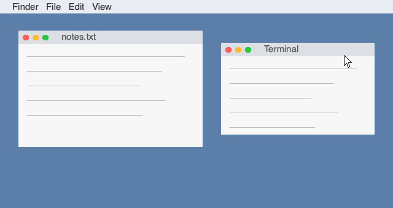
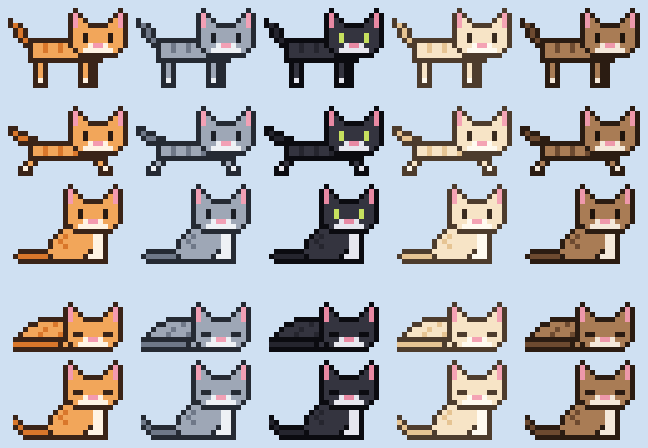

# Desktop Kitten 🐾

Pixel-art kittens that walk around **on top of your other apps** on macOS. Say
"kitten" and one walks onto the screen, say "more kittens" for a few more, and "bye
kittens" sends them running off. They wander, sit, nap, chase your mouse
pointer and purr with little hearts when you click them. Everything runs offline:
no API keys, no accounts, no internet after setup. Clicks go straight through to the
windows underneath unless you click a kitten.



*The GIF is rendered by [`scripts/make_demo_gif.py`](scripts/make_demo_gif.py) with the app's
own sprites and state machine on a drawn fake desktop. It is not a screen recording.*

| The five coats: walk, run, sit, sleep, purr |
|---|
|  |

All art is original and drawn in code (see [`sprites.py`](desktop_kitten/sprites.py)).

## Features

- **Transparent overlay:** a frameless, always-on-top window over the whole screen that
  shows on every desktop (Space) and over full-screen apps, with no Dock icon.
- **Click-through:** clicks pass through to your apps except on a kitten's visible
  pixels, so even the empty corners of a sprite don't block you.
- **Behavior state machine:** walk → sit → sleep, chase the mouse, purr when clicked,
  run off screen when dismissed.
- **Three ways to give commands:**
  | Command | Voice | Hotkey | Menu bar |
  |---|---|---|---|
  | Spawn one kitten | "kitten" / "kitty" / "hey kitten" | ⌃⌥K | Spawn a kitten |
  | Spawn several | "more kittens" / "kittens please" | ⌃⌥M | More kittens! |
  | Send them away | "bye kittens" / "goodbye kittens" | ⌃⌥B | Bye kittens |
- **Mood mode (optional, off by default):** uses the soft-label emotion CNN from my
  [facial-expression-recognition](https://github.com/bhavishyabondalapati/facial-expression-recognition)
  project to send a kitten when you've looked sad for 3 seconds.
- **Low CPU:** 0.0% when no kittens are out (see [CPU use](#cpu-use)).

## Tools and libraries

| Tool | Why it was chosen |
|---|---|
| **PySide6** (Qt for Python, `PySide6-Essentials`) | Transparent, frameless, always-on-top windows, a menu bar icon and fast 2D drawing in one well-supported library. The official Qt binding, LGPL-licensed. The "Essentials" package skips Qt's large extra modules. |
| **Vosk** + small English model (40 MB download) | Offline speech recognition that runs in real time on a CPU. Unlike Whisper, it can be limited to a fixed list of phrases (a *grammar*), which makes a tiny model accurate for a few commands at ~0.5% CPU. |
| **sounddevice** | Simple microphone access (wraps PortAudio, bundled in the macOS wheel). |
| **ctypes** (standard library) | Calls macOS APIs Qt doesn't expose (global hotkeys, window level, click-through) without adding PyObjC. |
| **PyTorch + OpenCV** (optional) | Only for mood mode: OpenCV finds the face, PyTorch runs the emotion CNN. Kept in a separate `requirements-mood.txt` so the normal install stays small. |
| **pytest** | Tests for the state machine, command parsing, sprites and mood logic. |
| **Pillow** | Only used to write the demo GIF. |
| **GitHub Actions** | Runs the tests on a macOS machine on every push. |

## File structure

```
desktop-kitten/
├── desktop_kitten/
│   ├── __init__.py            # marks the folder as a Python package
│   ├── __main__.py            # lets you run `python -m desktop_kitten`
│   ├── app.py                 # wires it all together: menu bar icon, hotkeys, voice, mood, command-line flags
│   ├── overlay.py             # the transparent always-on-top window: animation loop, drawing, click-through, petting
│   ├── behavior.py            # the kitten state machine (walk/sit/sleep/chase/purr/leave), pure Python
│   ├── sprites.py             # original pixel art as text grids, 5 coat colors, sprite sheets, pre-rendered images
│   ├── commands.py            # turns text like "more kittens" into a Command; the voice grammar and decoy words
│   ├── voice.py               # offline speech recognition with Vosk on a background thread
│   ├── hotkeys.py             # global keyboard shortcuts via the macOS Carbon API (ctypes)
│   ├── mood.py                # optional mood mode: webcam → face → emotion CNN → "sad for 3 s?" tracker
│   └── macos.py               # small Cocoa calls via ctypes: window level, all Spaces, click-through, no Dock icon
├── tests/
│   ├── conftest.py            # makes Qt draw offscreen so tests need no display
│   ├── test_behavior.py       # state machine: transitions, timing, chasing, petting, leaving, 2-minute random run
│   ├── test_commands.py       # command parsing, voice phrases vs decoys, hotkey parsing
│   ├── test_voice.py          # Vosk result handling: confidence filtering, rhyme rejection, model lookup
│   ├── test_sprites.py        # frame sizes, colors, mirroring, sprite sheet save/load round trip, hit testing
│   └── test_mood.py           # sadness tracker timing, missing-model message, frame loop with a fake camera
├── scripts/
│   ├── download_voice_model.py  # one-time download of the 40 MB Vosk model into models/
│   ├── evaluate_voice.py        # measures voice accuracy using macOS `say` voices (no microphone)
│   ├── measure_cpu.py           # measures the app's CPU use in 4 situations
│   ├── export_sprites.py        # writes assets/sprites/*.png and assets/preview.png from the code
│   └── make_demo_gif.py         # renders assets/demo.gif
├── assets/
│   ├── sprites/<coat>.png     # exported sprite sheets (one row per animation, 24×16 px frames)
│   ├── preview.png            # all coats and poses, for this README
│   └── demo.gif               # the demo animation at the top
├── .github/workflows/tests.yml  # CI: runs pytest on macOS for every push
├── requirements.txt           # main packages
├── requirements-mood.txt      # extra packages for mood mode only
├── pyproject.toml             # pytest settings
├── .gitignore                 # keeps secrets, caches, .DS_Store and the downloaded model out of git
└── README.md
```

`models/` (the downloaded speech model) is created by the download script and is not committed.

## Setup

```bash
cd ~/projects/desktop-kitten
conda create -n desktop-kitten python=3.12 -y
conda activate desktop-kitten
pip install -r requirements.txt
python scripts/download_voice_model.py     # one time, ~40 MB; skip it if you don't want voice
```

Optional, for mood mode only (about 700 MB installed, mostly PyTorch):

```bash
pip install -r requirements-mood.txt
```

Mood mode looks for the trained model at
`~/projects/facial-expression-recognition/weights/cnn_soft.pt`. Use `--mood-model PATH` or the
`KITTEN_MOOD_MODEL` environment variable to point somewhere else.

### macOS permissions

| Permission | Needed for | What happens |
|---|---|---|
| **Microphone** | voice commands | macOS asks the first time. If you said no: System Settings → Privacy & Security → Microphone → enable your terminal app. Turning "Voice commands" off in the menu releases the mic (the orange dot disappears). |
| **Camera** | mood mode only | macOS asks the first time you turn mood mode on. Click Allow, then turn mood mode on again. |
| Accessibility / Input Monitoring | *not needed* | The hotkeys use `RegisterEventHotKey`, which only receives the exact shortcuts registered. It never sees your other typing, so macOS doesn't require these permissions. Many hotkey tools (e.g. `pynput`) do need them because they watch *all* keys. |

Permissions are granted to the app that launches Python, usually Terminal, iTerm or VS Code.

## How to run

```bash
conda activate desktop-kitten
python -m desktop_kitten
```

A kitten walks in and a kitten-head icon appears in the menu bar. Useful flags:

```bash
python -m desktop_kitten --kittens 3     # start with 3 kittens (0 = none)
python -m desktop_kitten --no-voice      # don't use the microphone
python -m desktop_kitten --mood          # turn mood mode on at start
python -m desktop_kitten -v              # print what the microphone heard, with confidence
python -m desktop_kitten --help          # all options
```

Quit from the menu bar icon → Quit, or press Ctrl+C in the terminal.

**Run the tests:**

```bash
python -m pytest
```

**Re-measure things yourself:**

```bash
python scripts/evaluate_voice.py    # voice accuracy (uses `say`, no microphone)
python scripts/measure_cpu.py       # CPU use (shows real kittens on screen for ~2 minutes)
```

## Results

### CPU use

Measured with `scripts/measure_cpu.py` on an M4 Pro (average of 40 one-second `top` samples
after 15 s of warm-up; 100% = one full CPU core):

| Situation | App CPU |
|---|---|
| **Idle: no kittens, voice off** | **0.0%** |
| Idle: no kittens, voice listening | 1.9% |
| 4 kittens animating, voice off | 2.1% |
| 4 kittens animating, voice listening | 4.4% |

Drawing on screen also costs the macOS compositor (WindowServer), which isn't counted
above. I measured it separately: no measurable change with 4 kittens versus none, because
only the small areas around each kitten are redrawn. Spotlight indexing new files made
early measurements noisy, so let the Mac settle before measuring.

### Voice accuracy

From `scripts/evaluate_voice.py`: 8 command phrases and 20 non-command phrases, each spoken
by 7 built-in macOS voices (US, UK, Australian, Irish, Indian and South African English),
streamed in 0.25 s chunks exactly like the microphone:

| | Result |
|---|---|
| Commands understood | **56/56 (100%)** |
| False triggers on non-commands | 7/140 (5%), all from the single word **"kitchen"** |
| Recognizer CPU | ~0.4% of one core |

How it got there (each step measured with the same test):

| Approach | Commands understood | False triggers | CPU |
|---|---|---|---|
| Full vocabulary, no grammar | 12/40 | 3/60 | 10.7% |
| Grammar of command phrases only | 56/56 | 36/140 | 0.5% |
| + decoy words, including "kitchen" | 47/56 | 0/140 | 0.5% |
| **+ decoy words, without "kitchen" (used)** | **56/56** | **7/140** | **0.4%** |

**Known limitation:** saying "kitchen" by itself can summon a kitten. Adding "kitchen" as a
decoy fixed that, but it also captured real "kitten" spoken by the Australian, Irish and
South African voices. For a toy, I chose missing no real commands over a rare extra kitten.
Synthetic voices aren't real people in a real room, so treat these as rough numbers.

### Mood model check

The copied CNN agrees with the human majority vote on 82.7% of 600 FER+ validation images.
On faces at least 60% of annotators called sad, it predicts sadness 0.64 on average,
versus 0.03 for faces with no sad votes. The 0.4 threshold catches 86% of clearly sad faces
and none of the faces with zero sad votes.

## How it was built

1. **Drew the kittens.** Designed a 24×16 pixel kitten as text grids, where each letter is a
   *role* (outline, fur, stripes, white, eyes, pink) instead of a color. Built every pose from
   shared "stamps" (one head, several bodies, legs and tails) so the face stays the same in
   every frame. Rendered previews and fixed problems by looking at them: a gap under the body
   in the walk cycle, a floating tail in the run, feet on different ground lines.
2. **Wrote the state machine** as pure Python (no Qt) with an explicit table of allowed
   transitions, injected randomness and explicit time steps, so it could be fully tested.
3. **Built the overlay window** with PySide6: transparent, frameless, always on top. Added
   macOS calls through ctypes for the window level, showing on every Space, not stealing focus,
   no Dock icon, and switching click-through on and off.
4. **Made it cheap to run:** pre-rendered every sprite once, redraw only small dirty areas,
   drop to 10 fps when nobody is moving and stop the timer when no kittens are out.
5. **Added command parsing, global hotkeys and a menu bar icon.** Everything produces the
   same `Command`, so the rest of the app has one code path.
6. **Added offline voice with Vosk.** Measured accuracy with synthesized voices, found the
   rhyme problem ("mittens" → "kittens"), and fixed it with decoy words and a timing rule,
   checking each change with the same test.
7. **Added mood mode** by copying the CNN definition from the facial-expression project
   (so this repo doesn't import code from another repo) and checking that the copy loads
   the trained weights and reproduces sensible predictions. Found that macOS only shows the
   camera prompt when the camera is opened from the main thread, and fixed it.
8. **Verified on the real screen:** moved the pointer over a kitten, over an empty sprite
   corner and away, and checked macOS's `ignoresMouseEvents` flag each time. This caught one
   behavior problem: a kitten that "caught" the pointer sat *under* it and blocked the next
   click. It now stops beside the pointer.
9. **Wrote tests, CI, the measurement scripts and this README.**

## Key concepts (interview-ready)

### 1. The finite state machine (`behavior.py`)

A **finite state machine** means the kitten is always in exactly **one** of a few named states:
`WALK, SIT, SLEEP, CHASE, PURR, LEAVE`. Each state has:

- **its own update logic,** run every frame: WALK moves toward a target, SLEEP counts down
  and emits z's;
- **exit conditions:** a timer ran out, it reached its target, the pointer moved nearby, it was
  clicked, or the user said "bye".

```
           arrive (65%)           timer ends (30%)
   WALK ───────────────▶ SIT ─────────────────────▶ SLEEP
    ▲  ◀───────────────── │ ◀────────────────────── │
    │     timer ends (70%) │       timer ends         │
    │                      │ pointer moving nearby    │
    └── (35%) new spot     ▼                          │ click
                         CHASE ── caught / gave up ──▶ SIT
   click from WALK/SIT/SLEEP/CHASE ──▶ PURR ── 2.6 s ──▶ SIT
   "bye kittens" from any state ──▶ LEAVE ── off screen ──▶ removed
```

Why it's a good design:

- **Allowed transitions are data** (the `TRANSITIONS` table), and `_enter()` raises
  `IllegalTransition` for anything else. A bug like "a kitten that left wakes up again" fails
  loudly instead of looking weird.
- **The logic is separate from drawing.** It knows nothing about Qt; positions are numbers,
  time is passed in as `dt`, and randomness is a `random.Random` you pass in. So tests can run
  two simulated minutes in milliseconds with the same result every time.
- **Using `dt` (time since last frame)** keeps speeds in pixels per second, so a slow frame
  doesn't make kittens slower. `dt` is capped at 0.1 s so the Mac waking from sleep doesn't
  teleport them.
- **Chasing has a cooldown and needs a *moving* pointer,** so kittens don't follow you forever.
  This is how simple game AI is usually written.

### 2. The overlay window (`overlay.py`, `macos.py`)

- **One big transparent window:** Qt's `FramelessWindowHint` + `WA_TranslucentBackground` gives
  a window with no title bar whose pixels can be fully see-through. The kittens are just
  pictures drawn into it.
- **Staying on top:** the window level is set to macOS's *status* level (above normal windows
  and the Dock, below menus), and its *collection behavior* makes it appear on every Space and
  over full-screen apps.
- **Click-through** is the tricky part. A window either takes mouse events or ignores them
  (`NSWindow.ignoresMouseEvents`); macOS doesn't check pixel transparency for us. So every frame
  the app reads the pointer position (`QCursor.pos()`, which needs no permission) and asks:
  *is it over a non-transparent pixel of a kitten?* (checked against the original text grid, so
  it's exact). If yes, the window accepts clicks; otherwise clicks pass through. Switching only
  when the answer changes avoids extra work.
- **Not stealing focus:** it's a non-activating panel and the app is an "accessory" app
  (no Dock icon), so petting a kitten doesn't pull keyboard focus away from your editor.
- **Performance:** sprites are pre-rendered once into `QPixmap`s (GPU-friendly images); each
  frame only the union of each kitten's old and new rectangle is redrawn (a *dirty region*); the
  timer runs at 30 fps while something moves, 10 fps when everyone rests, and stops entirely
  when there are no kittens. That's how idle CPU reaches 0.0%.
- **Threads:** Qt widgets may only be touched from the main thread. Voice and mood run on
  background threads, so they *emit a Qt signal*. Qt queues the call and runs it on the main
  thread.

### 3. Offline speech recognition (`voice.py`, `commands.py`)

- **What Vosk does:** it's built on Kaldi. An *acoustic model* (a small neural network) turns
  each 10 ms slice of audio into probabilities of speech sounds (*phonemes*). A *decoding graph*
  combines those with a dictionary and a *language model* (which word sequences are likely) to
  find the most likely words. All of it runs on the CPU in real time, on this Mac only.
- **Grammar = a tiny language model.** Passing a phrase list means the decoder may only output
  those phrases or `[unk]`. With 8 phrases instead of a whole English vocabulary, a 40 MB model
  became far more accurate (12/40 → 56/56) and 20× cheaper (10.7% → 0.5% CPU).
- **The catch: forced choice.** A closed grammar always picks the *closest* phrase, so
  "mittens" came out as "kittens". Two fixes:
  1. **Decoy words** (mittens, bitten, written, chicken, ...) give the decoder a better match, and
     the parser ignores them. False triggers went from 36/140 to 7/140.
  2. **A timing rule:** a rhyme often splits into `[unk]` (the first consonant) + "kitten" with
     *zero* gap between them, while real speech ("oh, kitten") has a pause. Glued pairs are
     rejected.
- **Confidence filtering:** Vosk returns a confidence per word; words under 0.6 are dropped
  before parsing.
- **Streaming:** the mic delivers 0.25 s chunks. Vosk's built-in *endpointing* notices the
  short silence after a phrase and returns a final result, so a command fires right after you
  stop speaking instead of waiting for a fixed recording window.
- **Why Vosk over faster-whisper here:** Whisper is much better at free-form transcription, but
  it works on fixed-length windows (slow to react) and can't be restricted to a phrase list. For
  three always-listening commands, a streaming recognizer with a grammar fits better.

### 4. Mood mode in one breath

Webcam frame (4 per second) → OpenCV Haar face detector → largest face cropped to 48×48
grayscale (the FER+ format) → CNN → probability of "sadness" → **smoothed** with an exponential
moving average → must stay above 0.4 for **3 seconds straight** → spawn a kitten → **90 s
cooldown**. The soft-label model was trained on the *share* of annotators choosing each emotion,
so its output reads like "how many people would call this face sad", which suits a gentle
trigger. Nothing is saved, and the camera is released as soon as mood mode is turned off.

## What I couldn't verify automatically

These were tested as far as possible, but need a real person once:

- **Pressing the hotkeys.** macOS blocks scripted keystrokes from the tool I built this with.
  Registering the shortcuts succeeds, so press ⌃⌥K once to confirm.
- **Mood mode with your face.** The camera permission prompt has to be accepted by you. The
  frame loop is tested with a fake camera, and the model was checked on FER+ images.
- **Voice in a real room:** tested end-to-end through the real microphone with the Mac's own
  speaker, but not with your voice.
- **A screen recording:** screen capture permission wasn't available while building, so the GIF
  is rendered rather than recorded.
